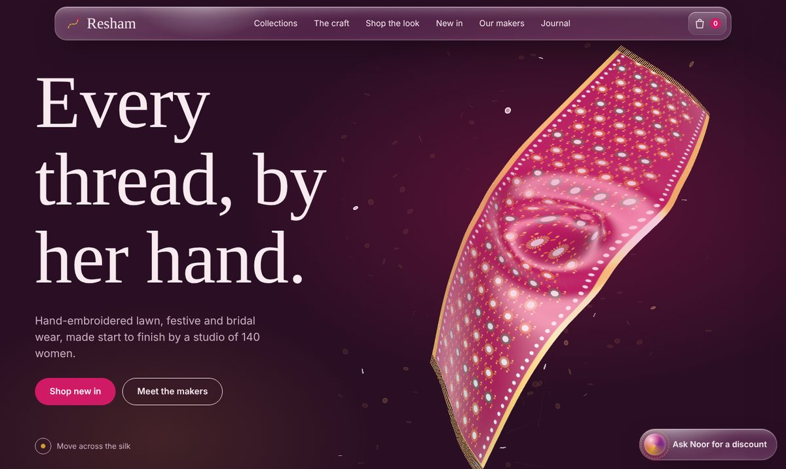
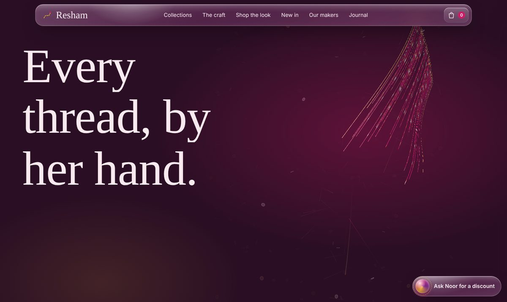
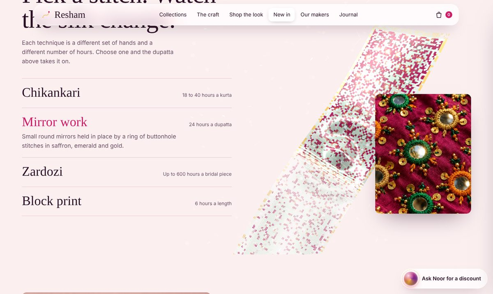
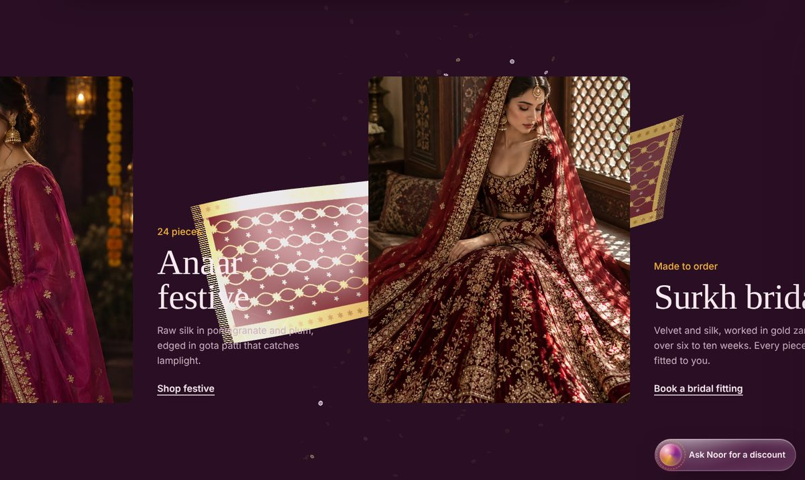
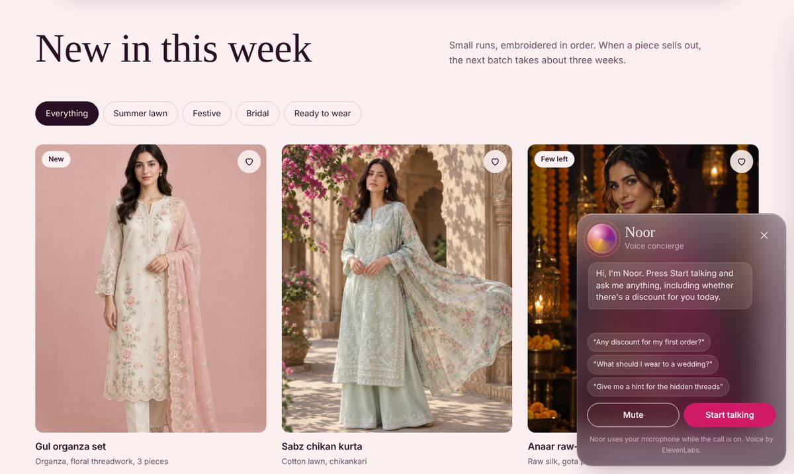
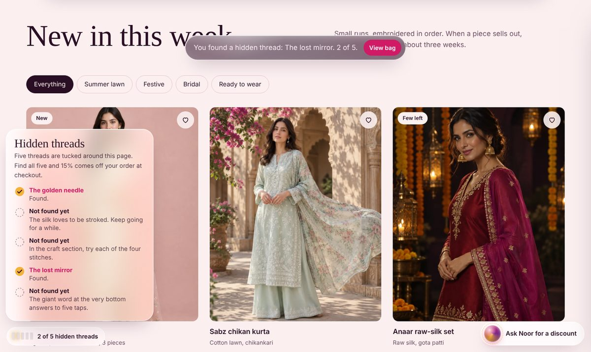
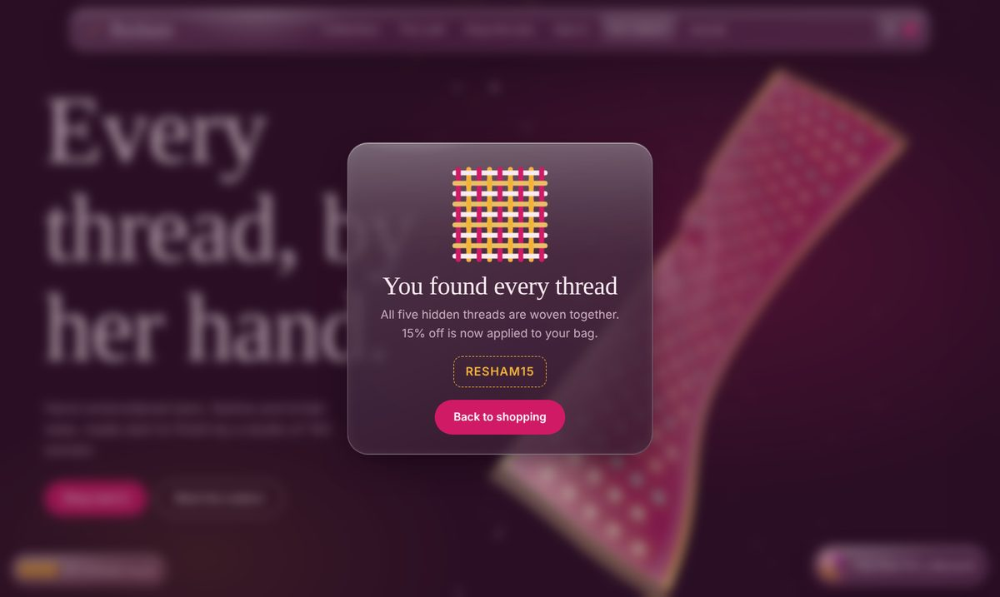
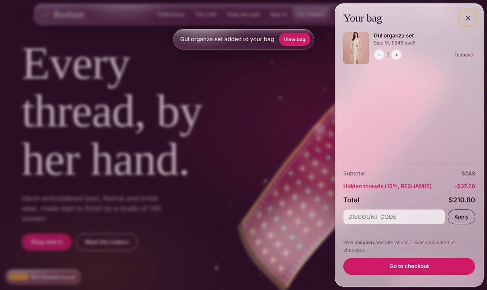
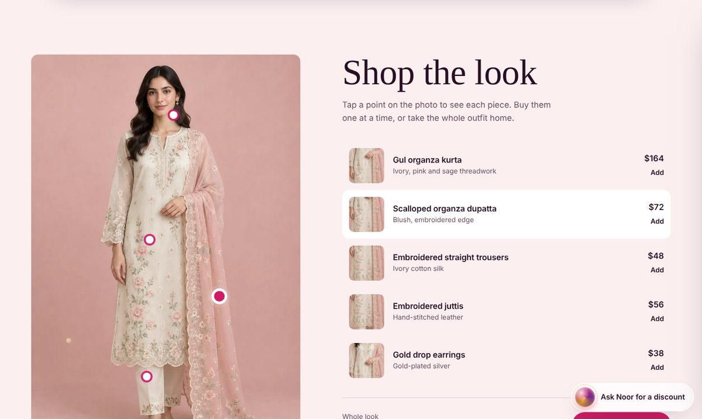
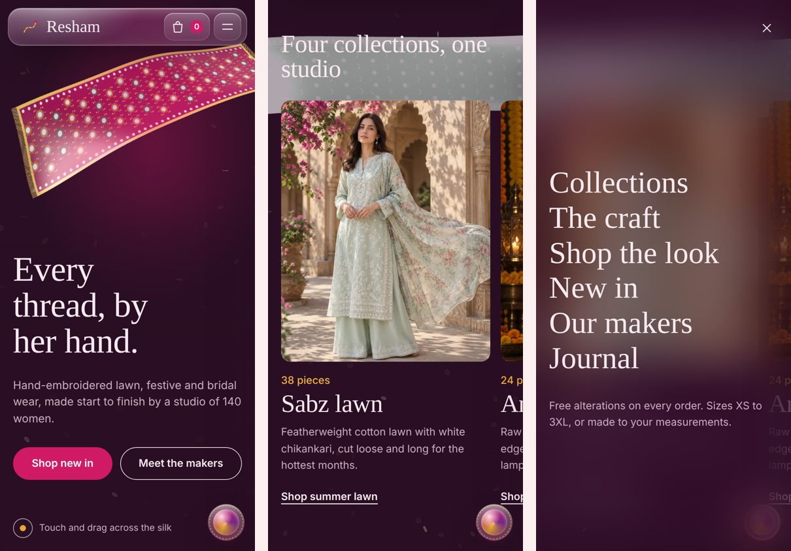

# Resham: hand-embroidered womenswear

**Live site:** https://resham-ruby.vercel.app

Made by Usman Nadeem · https://github.com/Matanza00

A concept website for a womenswear house built around hand embroidery, with a silk dupatta in Three.js that is woven thread by thread in front of you, a voice concierge you can ask for a discount, and five hidden threads that unlock 15% off.



## What's inside

### A silk dupatta, woven in Three.js
- **Threads first, then cloth.** Golden threads fly in and sew into the cloth. Then a shader weaves it: warp threads run down first, and the weft fills in row by row behind a glowing shuttle line.
- **It unravels as you leave and re-weaves when you come back.** Scroll past the 3D sections and the cloth comes apart into threads.
- **Real fabric shading.** The silk has a long highlight that runs across the weave, gold zari that glints, and fringed ends. It ripples where you touch it or move the cursor.
- **The print changes with the page.** Each collection has its own print (chikankari, gota, zardozi, block print), and picking a craft reprints the cloth stitch by stitch. All prints are drawn in code on a canvas, so there are no texture files to load.




### Liquid-glass interface
The header, bag, menu, toasts, dialogs, voice panel and hidden-threads tracker share one iOS-style glass system:
- frosted blur and saturation
- inner light edges and a specular highlight that follows your cursor
- a glass "lens" that slides under the section you're reading



### Noor, a voice concierge (ElevenLabs Agents)
Tap **Ask Noor for a discount** and talk to her. She recommends outfits and scrolls the page to show them. If you ask nicely, she negotiates a discount of 5 to 10%. The page enforces that limit, so the agent can't be talked past it. Details are in [`agent/README.md`](agent/README.md).



### Five hidden threads = 15% off
Five easter eggs are hidden around the page. A glass tracker appears after the first one you find and gives a hint for each one still missing. Find all five and a woven swatch animates in, and **RESHAM15** is applied in the bag.

Only one discount applies per order (the bigger one).

<details><summary>Spoilers</summary>

1. Tap the needle next to the logo three times quickly.
2. Stroke the silk for a few seconds.
3. Try all four stitches in the craft section.
4. Find the tiny mirror glinting in the shop-the-look photo.
5. Tap the giant "Resham" at the bottom five times.
</details>





### Shop features
Bag drawer, sizes, wishlist, collection filters, shop-the-look hotspots, a 3-question outfit finder, a bridal fitting form and discount codes. Checkout, the newsletter and fitting requests are **not connected** to a backend yet. They say so on screen.



### Mobile
Built for touch: you drag a finger across the silk, the collection reel becomes a swipe carousel, and the menu is a full-screen glass sheet.



## Stack
Three.js (custom GLSL shaders) · GSAP ScrollTrigger · Lenis · ElevenLabs Agents (`@elevenlabs/client`) · esbuild · Vercel. Campaign photos are AI-generated.

## Run it
```bash
npm install
npm run build        # bundles src/ into dist/
npx serve dist       # or any static server
```
Source lives in `src/index.html` and `src/main.js`, and `dist/` is the deployable site. Vercel runs the build itself (see `vercel.json`). The voice concierge needs HTTPS and microphone permission.

## License
Source-available under the **PolyForm Noncommercial License 1.0.0** (`LICENSE.md`).

- **Allowed:** using, studying, changing and sharing this project for personal, educational and other noncommercial purposes, and contributing improvements (see `CONTRIBUTING.md`).
- **Not allowed without written permission:** selling this project or any copy or adaptation of it, or using it to earn money, for example as a paid client site, a template you sell, or a commercial product.

For a commercial license, contact NXCSOL at https://nxcsol.com.

Third-party libraries (Three.js, GSAP, Lenis, the ElevenLabs client) keep their own licenses.
